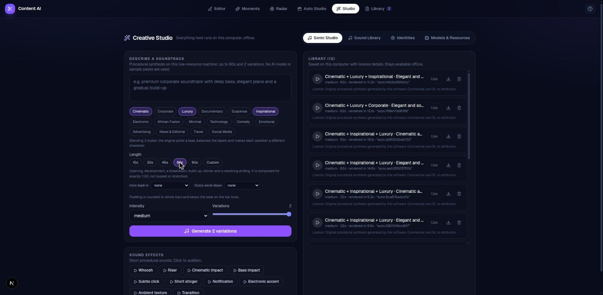

# Content AI

**A local-first studio that turns raw footage, photos or a one-line idea into finished short videos, and composes the music for them.**
Everything runs on your own computer: no cloud, no paid API, no sample packs. Built with Next.js 16, Python (OpenCV, faster-whisper) and ffmpeg.

| | |
|---|---|
| **Auto Studio** | Describe a video in plain English, add media (or none), press Create. |
| **Sonic Studio** | Compose original soundtracks of any length from blended styles. |
| **Editor and Moments** | Find the best moments in long videos and cut them for every platform. |
| **Live Radar** | Watch creators and get notified when they go live. |

## See it working

### Describe a soundtrack, pick styles, choose a length
Select up to four styles and the engine **blends** them into one composition rather than stacking tracks. Choose 15, 30, 45, 60 or 90 seconds, or a custom length (optionally with an intro lead-in and outro wind-down). Each variation is a genuinely different character, and every library track can be played or downloaded.



### Compose from styles and manage your sound library
The library composer shows how each blend was built, with generated artwork, tempo, energy and licence status per track. Everything is stored locally with its licence record, and tracks can be favourited, imported (with the licence you record), played, downloaded or deleted.


### Auto Studio: from a sentence to a finished video
Describe the video, set format, duration and style, optionally blend a soundtrack and choose the sound effects that land on each transition. **Idea-to-Video** needs no uploads at all; **Mixed media** wraps your own photos and clips in generated scenes.


## What is inside

### Auto Studio
`ingest → analyse → understand the instruction → soundtrack → compose on the beat → render → QC → export`
- Four creation modes: Idea-to-Video, Image-to-Video, Video-to-Video, Mixed media.
- Generated scenes (animated backgrounds, typography, charts, transitions), a 2D / 2.5D / real-3D engine, and an automated QC pass.
- Conversational refinement ("make it calmer", "shorter", "change the headline to ..."). Only what changed is re-rendered; shots are cached by content hash.
- Brand kits (logo, palette, tagline) applied automatically.
- Headline and closing text only ever use words you typed. Nothing about your business is invented.

### Sonic Studio (procedural music, no AI model)
- **Duration-aware composition.** The engine writes a complete piece for the requested length instead of looping a short one: opening, development, breakdown, build-up, climax, variation and a resolving ending, with its own chord progression per section, evolving melody, rhythmic variation, risers, fills and impacts.
- **Style blending.** Cinematic, Corporate, Luxury, Ambient, Electronic, African Fusion, Inspirational, Dramatic, Minimal and Experimental. The blend resolves a lead, tempo compatibility, key and energy, and carves frequency overlap.
- **Variations** with four characters (cinematic and dramatic, elegant, modern, minimal) that shape the arc differently.
- Ten sound effects (whoosh, riser, impact, stinger, and more) that you can audition and place on transitions.
- Original synthesis only, so licensing is simple: commercial use is fine and every track records its licence.

### Editor, Moments and AI Director
Upload a file or ingest a YouTube URL (with an ownership confirmation), score attention and find candidate moments, cut with 9:16 framing, burned-in captions, face-aware framing and per-platform presets. The AI Director turns a plain-English instruction into an editing plan, using rules first and an optional local LLM second.

### Live Radar
Track creators and detect when they go live through a configurable HTTP provider. Without a provider every status stays `UNKNOWN`; nothing is guessed. See `docs/LIVE_RADAR_SETUP.md`.

## Getting started

### Requirements
| Needed | For |
|---|---|
| Node.js 22+ | the app and the test scripts |
| Python 3.10+ | video analysis, transcription, scene rendering |
| `ffmpeg` and `ffprobe` on your `PATH` | every render and cut |
| `yt-dlp` (optional) | importing from YouTube URLs |
| a `llama.cpp` build (optional) | the local AI model (Models & Resources tab) |

### Install and run
```bash
git clone https://github.com/hakizimana-fred/content-ai.git
cd content-ai

npm install

python3 -m venv .venv
.venv/bin/pip install -r requirements.txt

cp .env.example .env.local     # only needed for Live Radar

npm run dev                    # http://localhost:3000
```
Everything you create is stored under `storage/` (git-ignored) and never leaves your machine.

### Configuration
| Variable | Purpose |
|---|---|
| `FFMPEG_PATH`, `FFPROBE_PATH` | use a specific ffmpeg build |
| `LLAMA_SERVER_BIN` | path to `llama-server` for the optional local model |
| `AUTO_DATA_DIR`, `STUDIO_DATA_DIR` | keep generated media somewhere else (for example a bigger disk) |
| `RADAR_*` | Live Radar provider, see `.env.example` |

### Tests
```bash
npm run test:studio       # engines, sound, mix, blend, arrangement, brand, auto pipeline
npm run test:auto:e2e     # renders real videos end to end (slow)
npm run test:radar        # Live Radar
npx tsc --noEmit          # type-check
```

## Project layout
```
src/app/            Next.js app and API routes (auto, studio, radar, video, projects)
src/components/     UI: Auto Studio, Studio (Sonic, Library, Identities), Moments, Radar, Editor
src/lib/studio/     sound engine (sonic, arrange, blend, dsp, mix), AI Director, models, identities
src/lib/auto/       Auto Studio pipeline, scenes, creative director, QC, brand, 3D
src/lib/intelligence/  attention scoring, transcription, moment detection
src/lib/radar/      live detection, state machine, notifications
scripts/            test and evaluation scripts
docs/               deeper guides (see below)
```

## Documentation
- [`docs/AUTO_STUDIO.md`](docs/AUTO_STUDIO.md): the Auto Studio pipeline, refinement phrases, limits
- [`docs/STUDIO.md`](docs/STUDIO.md): Creative Studio, sound design, mixing, models
- [`docs/LIVE_RADAR.md`](docs/LIVE_RADAR.md) and [`docs/LIVE_RADAR_SETUP.md`](docs/LIVE_RADAR_SETUP.md)
- [`docs/ROADMAP.md`](docs/ROADMAP.md): architecture map and what is next

## Good to know
- **It is local and CPU-friendly, not instant.** A 90-second soundtrack renders in roughly 13 seconds on a 4-core laptop; video renders take longer and run one at a time.
- **Disk use grows.** Rendered projects are cached under `storage/auto`. Delete projects you no longer need.
- **Dev server memory.** If `npm run dev` ever balloons in memory, stop it, delete `.next`, and start again. Tailwind is deliberately limited to scanning `src/` (see the first line of `src/app/globals.css`) so it does not read your media.
- **Limits are documented honestly.** Face analysis is classical (frontal Haar), tempo detection can pick a rhythmic multiple on imported polyrhythmic tracks, and transcription quality for lower-resource languages depends on the Whisper model.
- Only download or ingest content you have the rights to use.
