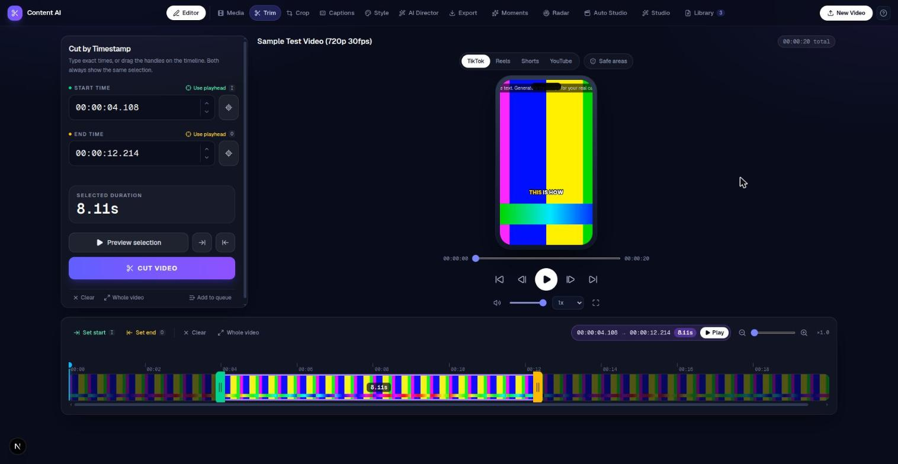
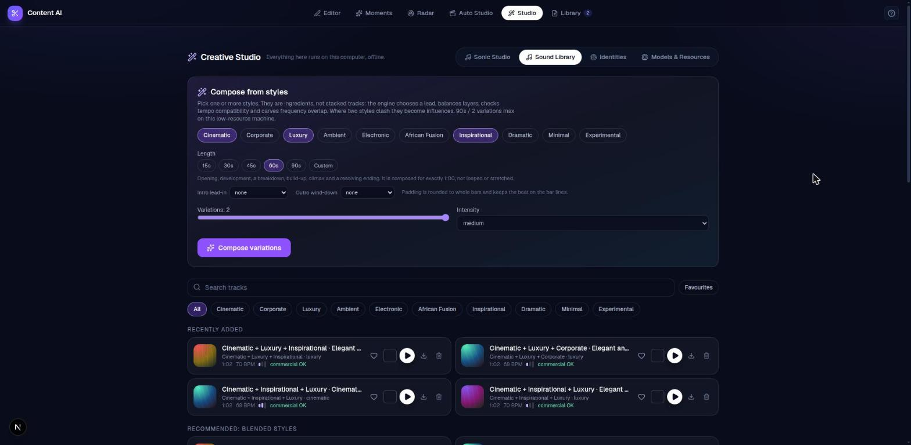
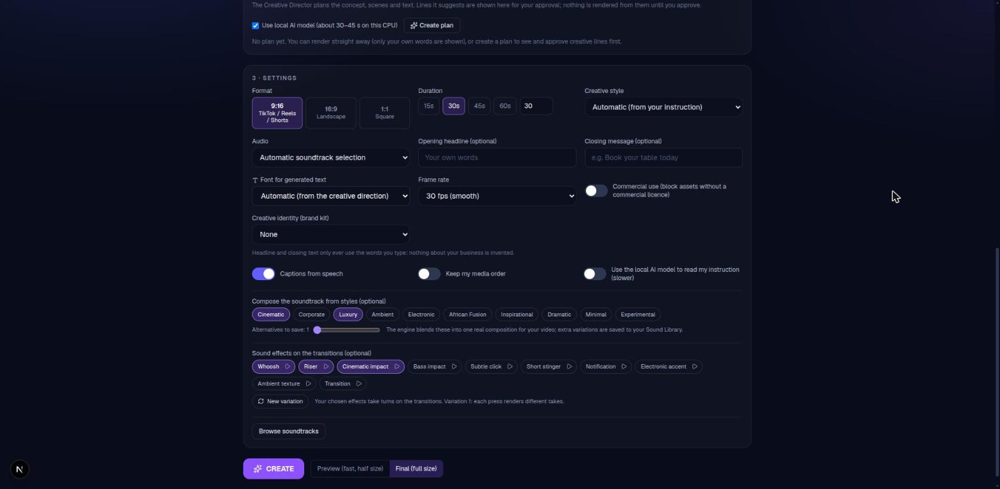

# Content AI

**A local-first studio that turns raw footage, photos or a one-line idea into finished short videos, and composes the music for them.**
Everything runs on your own computer: no cloud, no paid API, no sample packs. Built with Next.js 16, Python (OpenCV, faster-whisper) and ffmpeg.

| | |
|---|---|
| **Auto Studio** | Describe a video in plain English, add media (or none), press Create. |
| **Sonic Studio** | Compose original soundtracks of any length from blended styles. |
| **Editor and Moments** | Find the best moments in long videos and cut them for every platform. |
| **Live Radar** | Watch creators and get notified when they go live. |

## See it working

### Editor: cut, reframe and caption for every platform
Load a video (upload, or a YouTube URL you own), then drag on the timeline or type exact start and end times to select a segment. The phone preview shows the result in **TikTok, Reels, Shorts or YouTube** framing, with optional safe-area guides so nothing lands under the platform's buttons. Trim, crop, caption, style and export from one place. The screenshot uses the built-in sample video (**Load Instant Sample Video** on the start screen), so you can try everything without your own footage.



### Describe a soundtrack, pick styles, choose a length
Select up to four styles and the engine **blends** them into one composition rather than stacking tracks. Choose 15, 30, 45, 60 or 90 seconds, or a custom length (optionally with an intro lead-in and outro wind-down). Each variation is a genuinely different character, and every library track can be played or downloaded.


### Compose from styles and manage your sound library
The library composer shows how each blend was built, with generated artwork, tempo, energy and licence status per track. Everything is stored locally with its licence record, and tracks can be favourited, imported (with the licence you record), played, downloaded or deleted.



### Auto Studio: from a sentence to a finished video
Describe the video, set format, duration and style, optionally blend a soundtrack and choose the sound effects that land on each transition. **Idea-to-Video** needs no uploads at all; **Mixed media** wraps your own photos and clips in generated scenes.



## What is inside

### Auto Studio
`ingest → analyse → understand the instruction → soundtrack → compose on the beat → render → QC → export`
- Four creation modes: Idea-to-Video, Image-to-Video, Video-to-Video, Mixed media.
- Generated scenes (animated backgrounds, typography, charts, transitions), a 2D / 2.5D / real-3D engine, and an automated QC pass.
- Conversational refinement ("make it calmer", "shorter", "change the headline to ..."). Only what changed is re-rendered; shots are cached by content hash.
- Brand kits (logo, palette, tagline) applied automatically.
- Headline and closing text only ever use words you typed. Nothing about your business is invented.

### Sonic Studio (procedural music, no AI model)
- **Duration-aware composition.** The engine writes a complete piece for the requested length instead of looping a short one: opening, development, breakdown, build-up, climax, variation and a resolving ending, with its own chord progression per section, evolving melody, rhythmic variation, risers, fills and impacts.
- **Style blending.** Cinematic, Corporate, Luxury, Ambient, Electronic, African Fusion, Inspirational, Dramatic, Minimal and Experimental. The blend resolves a lead, tempo compatibility, key and energy, and carves frequency overlap.
- **Variations** with four characters (cinematic and dramatic, elegant, modern, minimal) that shape the arc differently.
- Ten sound effects (whoosh, riser, impact, stinger, and more) that you can audition and place on transitions.
- Original synthesis only, so licensing is simple: commercial use is fine and every track records its licence.

### Editor
A focused video cutter with one tab per job:

| Tab | What it does |
|---|---|
| **Media** | Your imported videos and the YouTube ingest (needs an ownership confirmation first). |
| **Trim** | Select a segment by dragging handles on the filmstrip timeline or typing exact times (millisecond precision); set start/end from the playhead with `I` and `O`/`0`, preview the selection, and add several cuts to a queue. |
| **Crop** | Reframe landscape footage for vertical: **Auto Track** (finds faces, picks the one that is speaking and pans smoothly to keep them in frame), Centre, Left, Right, or Manual (drag the picture in the preview). |
| **Captions** | Caption Studio: speech-to-text with faster-whisper, burned into the video, with styles such as word-by-word highlight and karaoke sweep and control over words per line. |
| **Style** | Choose the platform frame (TikTok, Reels, Shorts, YouTube) and toggle safe-area guides. |
| **AI Director** | Type an instruction such as "make a punchy 30-second TikTok of the funniest part with captions"; it becomes an editing plan you review. Rules run first, and the optional local Qwen model handles harder instructions. |
| **Export** | Pick the platform preset (TikTok, Reels, Shorts, YouTube) and export. Clips land in your Library, where you can preview, download, retry or hand them to the share dialog. |

Keyboard shortcuts are listed under the `?` button in the top bar.

### Moments
Scores attention across a long video from its loudness and silence pattern plus what is said (transcript text, weighted by how reliable the transcript is), and lists the candidate highlights. Cuts are snapped to sentence boundaries so a clip never starts or ends mid-sentence.

### Live Radar
Track creators and detect when they go live through a configurable HTTP provider. Without a provider every status stays `UNKNOWN`; nothing is guessed. See `docs/LIVE_RADAR_SETUP.md`.

## Getting started

### Requirements
| Needed | For | Required? |
|---|---|---|
| Node.js 22+ and npm | the app and the test scripts | yes |
| Python 3.10+ with `venv` | video analysis, transcription, scene rendering | yes |
| `ffmpeg` and `ffprobe` on your `PATH` | every render and cut | yes |
| `yt-dlp` | importing from YouTube URLs | optional |
| `git`, `cmake`, a C/C++ compiler | building `llama.cpp` | optional (local AI model) |
| ~1.1 GB free disk and ~2 GB free RAM | the Qwen2.5 1.5B model | optional (local AI model) |

The soundtrack engine, rule-based AI Director, captions and rendering work **without** the optional pieces. The local LLM only makes instruction understanding and creative planning smarter.

### 1. System tools
**Ubuntu / Debian**
```bash
sudo apt update
sudo apt install -y git curl build-essential cmake ffmpeg python3 python3-venv python3-pip
# Node.js 22 (via nvm, or use your preferred installer)
curl -fsSL https://raw.githubusercontent.com/nvm-sh/nvm/v0.40.1/install.sh | bash
source ~/.nvm/nvm.sh && nvm install 22
```
**macOS (Homebrew):** `brew install node@22 python ffmpeg cmake git`
**Windows:** use WSL2 with Ubuntu and follow the Ubuntu steps (the scripts and paths assume a Unix shell).

Check:
```bash
node -v && python3 --version && ffmpeg -version | head -1 && ffprobe -version | head -1
```

### 2. Install and run the app
```bash
git clone https://github.com/hakizimana-fred/content-ai.git
cd content-ai

npm install

python3 -m venv .venv
.venv/bin/pip install -r requirements.txt

cp .env.example .env.local     # only needed for Live Radar

npm run dev                    # http://localhost:3000
```
Everything you create is stored under `storage/` (git-ignored) and never leaves your machine.

On first use, captions and Moments download the small **Whisper** speech model (`base`, about 140 MB) from Hugging Face once, then run fully offline. To pre-download it:
```bash
.venv/bin/python3 -c "from faster_whisper import WhisperModel; WhisperModel('base', device='cpu', compute_type='int8')"
```

### 3. Optional: YouTube import (`yt-dlp`)
```bash
python3 -m pip install --user -U yt-dlp      # installs to ~/.local/bin
yt-dlp --version
```
Make sure `~/.local/bin` is on your `PATH`, or set `YT_DLP_PATH=/full/path/to/yt-dlp` in `.env.local`.

### 4. Optional: local AI model (llama.cpp + Qwen2.5)
The app runs the model with `llama-server` from [llama.cpp](https://github.com/ggml-org/llama.cpp), bound to `127.0.0.1:8089` only (never exposed to your network), at reduced CPU priority and one model at a time. By default it looks in `~/.local/share/content-ai/`:

```
~/.local/share/content-ai/
├── llama.cpp/build/bin/llama-server     ← the llama.cpp build
└── models/qwen2.5-1.5b-instruct-q4_k_m.gguf
```

**a) Build llama.cpp** (CPU-only, a few minutes):
```bash
mkdir -p ~/.local/share/content-ai && cd ~/.local/share/content-ai
git clone --depth 1 https://github.com/ggml-org/llama.cpp.git
cd llama.cpp
cmake -B build -DCMAKE_BUILD_TYPE=Release
cmake --build build --config Release -j"$(nproc)" --target llama-server llama-cli
ls build/bin/llama-server            # should exist
```
(With an NVIDIA GPU add `-DGGML_CUDA=ON` to the first `cmake` command.)

**b) Download Qwen2.5** (Apache-2.0, safe for commercial use). Pick one:

| Model | Download | RAM | Use when |
|---|---|---|---|
| **Qwen2.5 1.5B Instruct Q4_K_M** (recommended) | 1.07 GB | ~1.8 GB | default; about 6 tokens/s on an older 4-core laptop CPU |
| Qwen2.5 0.5B Instruct Q4_K_M | 0.47 GB | ~0.7 GB | very low memory; weakest planner |

```bash
mkdir -p ~/.local/share/content-ai/models && cd ~/.local/share/content-ai/models

# recommended
curl -L -O https://huggingface.co/Qwen/Qwen2.5-1.5B-Instruct-GGUF/resolve/main/qwen2.5-1.5b-instruct-q4_k_m.gguf
echo "6a1a2eb6d15622bf3c96857206351ba97e1af16c30d7a74ee38970e434e9407e  qwen2.5-1.5b-instruct-q4_k_m.gguf" | sha256sum -c -

# or the small one
curl -L -O https://huggingface.co/Qwen/Qwen2.5-0.5B-Instruct-GGUF/resolve/main/qwen2.5-0.5b-instruct-q4_k_m.gguf
echo "74a4da8c9fdbcd15bd1f6d01d621410d31c6fc00986f5eb687824e7b93d7a9db  qwen2.5-0.5b-instruct-q4_k_m.gguf" | sha256sum -c -
```
Both checksums are the ones pinned in `src/lib/studio/models.ts`; `sha256sum -c` must print `OK`. The 3B Qwen model is deliberately not offered: its licence is non-commercial.

**c) Smoke test** the runtime before opening the app:
```bash
~/.local/share/content-ai/llama.cpp/build/bin/llama-cli \
  -m ~/.local/share/content-ai/models/qwen2.5-1.5b-instruct-q4_k_m.gguf \
  -p "Say hello in five words." -n 24 -st < /dev/null
```
You should see a short greeting and a speed line such as `Generation: 11.0 t/s`. (On older llama.cpp builds `-st` does not exist; use `-no-cnv` instead.)

**d) Use it in the app.** Open **Studio → Models & Resources**. It reads your hardware (CPU threads, RAM, AVX2, GPU), shows the models that fit, and reports whether `llama-server` and the model file were found. Tick *Use local AI model* in Auto Studio's Creative Plan, or the AI Director option in the Editor.

**Keeping files elsewhere** (for example on a bigger disk) with environment variables in `.env.local`:
```bash
STUDIO_HOME=/mnt/big/content-ai          # parent of llama.cpp/ and models/
LLAMA_SERVER_BIN=/opt/llama/llama-server # use an existing build
STUDIO_MODELS_DIR=/mnt/big/models
LLAMA_PORT=8089
```

**Troubleshooting**
| Symptom | Fix |
|---|---|
| `llama-server not found at ...` | the build is missing or in a different folder; check step (a) or set `LLAMA_SERVER_BIN` |
| `model file missing: ...` | the `.gguf` must have exactly the file name above, inside `models/` |
| Model fails to load, or the machine slows down | use the 0.5B model, and close other heavy apps; only one model is ever loaded |
| `cmake: command not found` | `sudo apt install cmake` (or `brew install cmake`) |
| Slow answers | expected on CPU: a creative plan takes about 30-45 s on a 4-core laptop; rule-based planning is instant and needs no model |

### Configuration
| Variable | Purpose |
|---|---|
| `FFMPEG_PATH`, `FFPROBE_PATH` | use a specific ffmpeg build |
| `STUDIO_HOME`, `STUDIO_MODELS_DIR`, `LLAMA_SERVER_BIN`, `LLAMA_PORT` | where the optional local model and `llama.cpp` live (see section 4 above) |
| `YT_DLP_PATH` | use a specific `yt-dlp` binary |
| `AUTO_DATA_DIR`, `STUDIO_DATA_DIR` | keep generated media somewhere else (for example a bigger disk) |
| `RADAR_*` | Live Radar provider, see `.env.example` |

### Tests
```bash
npm run test:studio       # engines, sound, mix, blend, arrangement, brand, auto pipeline
npm run test:auto:e2e     # renders real videos end to end (slow)
npm run test:radar        # Live Radar
npx tsc --noEmit          # type-check
```

## Project layout
```
src/app/            Next.js app and API routes (auto, studio, radar, video, projects)
src/components/     UI: Auto Studio, Studio (Sonic, Library, Identities), Moments, Radar, Editor
src/lib/studio/     sound engine (sonic, arrange, blend, dsp, mix), AI Director, models, identities
src/lib/auto/       Auto Studio pipeline, scenes, creative director, QC, brand, 3D
src/lib/intelligence/  attention scoring, transcription, moment detection
src/lib/radar/      live detection, state machine, notifications
scripts/            test and evaluation scripts
docs/               deeper guides (see below)
```

## Documentation
- [`docs/AUTO_STUDIO.md`](docs/AUTO_STUDIO.md): the Auto Studio pipeline, refinement phrases, limits
- [`docs/STUDIO.md`](docs/STUDIO.md): Creative Studio, sound design, mixing, models
- [`docs/LIVE_RADAR.md`](docs/LIVE_RADAR.md) and [`docs/LIVE_RADAR_SETUP.md`](docs/LIVE_RADAR_SETUP.md)
- [`docs/ROADMAP.md`](docs/ROADMAP.md): architecture map and what is next

## Good to know
- **It is local and CPU-friendly, not instant.** A 90-second soundtrack renders in roughly 13 seconds on a 4-core laptop; video renders take longer and run one at a time.
- **Disk use grows.** Rendered projects are cached under `storage/auto`. Delete projects you no longer need.
- **Dev server memory.** If `npm run dev` ever balloons in memory, stop it, delete `.next`, and start again. Tailwind is deliberately limited to scanning `src/` (see the first line of `src/app/globals.css`) so it does not read your media.
- **Limits are documented honestly.** Face analysis is classical (frontal Haar), tempo detection can pick a rhythmic multiple on imported polyrhythmic tracks, and transcription quality for lower-resource languages depends on the Whisper model.
- Only download or ingest content you have the rights to use.
